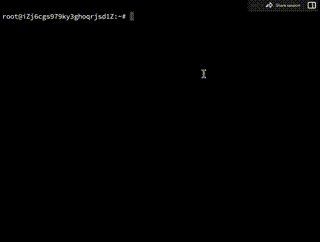

<div dir="rtl" align="center">


# سامانه جامع BitLite System

**کنسول مدیریت پروکسی چند استخری همزمان (Multi-Pool Proxy)، نود اختصاصی استخر و کنترل دسترسی سطح دستگاه**

[](https://github.com/clonerdev/BitLite-System)
[](./LICENSE)
[](#۱-نصب-خودکار-روی-سرور-لینوکس-پیشنهادی)
[](./README.md)

**[🇮🇷 مستندات فارسی (README.fa.md)](./README.fa.md)** • **[🇬🇧 English Documentation (README.md)](./README.md)** • **[📦 مخزن گیت‌هاب](https://github.com/clonerdev/BitLite-System)**

<br />

<!-- نمایش آیکون ارزهای پشتیبانی‌شده -->
<p align="center">
  
  &nbsp;
  
  &nbsp;
  
  &nbsp;
  
  &nbsp;
  
  &nbsp;
  
  &nbsp;
  
  &nbsp;
  
  &nbsp;
  
  &nbsp;
  
  &nbsp;
  
  &nbsp;
  
</p>


</div>

---

<div dir="rtl">

## معرفی پروژه

**BitLite System** یک سامانه یکپارچه برای مدیریت فارم‌های استخراج رمزارز، راه‌اندازی خطوط پروکسی استراتوم چند استخری (Simultaneous Multi-Pool Proxy)، پیاده‌سازی نودهای مستقل استخر ماینینگ و مدیریت دقیق دسترسی ماینرها در سطح دستگاه است. این سامانه با رابط کاربری کاملاً دوزبانه (فارسی راست‌به‌چپ و انگلیسی) طراحی شده تا اپراتورهای فارم و مدیران استخرهای خصوصی بتوانند تمامی خطوط ارتباطی، استخرهای مقصد، نرخ کارمزد (DevFee) و مجوزهای اتصال مشتریان خود را از یک پنل واحد مدیریت کنند.

سه مزیت اصلی **BitLite System** نسبت به پروکسی‌های معمولی:
۱. **پشتیبانی از چند استخر همزمان روی هر پورت (Simultaneous Multi-Pool Routing)**: هر پورت ورودی می‌تواند به‌طور همزمان به چندین استخر مختلف (مثلاً **ViaBTC + F2Pool + AntPool + استخر اختصاصی**) متصل شود و هش‌ریت ماینرها را بر اساس درصد دلخواه (`Load Balance %`)، اتصال همزمان کمترین پینگ (`Simultaneous`) یا جایگزینی خودکار (`Priority Failover`) توزیع کند.
۲. **کاتالوگ استخرهای معروف جهانی (ViaBTC و غیره) + افزودن دستی استخر**: تمامی استخرهای معتبر از جمله **ViaBTC**، **F2Pool**، **AntPool**، **Binance Pool**، **Foundry USA**، **SpiderPool**، **Poolin**، **EMCD**، **Braiins** و **Luxor** به‌صورت آماده در پنل قرار دارند و علاوه بر آن می‌توانید هر استخر دلخواه را به‌صورت دستی اضافه و در سرور ذخیره کنید.
۳. **کنترل دسترسی سطح دستگاه (`Wallet.Worker.Device`)**: هر ماینر پیش از برقراری نشست استراتوم بر اساس شناسه دقیق سه‌بخشی بررسی شده، سقف اتصال همزمان هر دستگاه و سهمیه کل کیف‌پول مشتری (بر اساس پلن پرداختی) کنترل می‌شود و مدیر می‌تواند در لحظه هر دستگاه را بدون ری‌استارت کردن کل پورت، قطع یا مسدود کند.

---

## معماری سامانه و مسیریابی چند استخری

</div>

<div align="center">
  
</div>

---

<div dir="rtl">

## قابلیت‌های کلیدی

### ۱. پشتیبانی از چند استخر همزمان (Simultaneous Multi-Pool Routing)
- امکان اتصال همزمان هر پورت پروکسی به **چندین استخر ماینینگ در یک لحظه** از طریق تب **«چند استخری همزمان (Multi-Pool)»** با ۳ استراتژی مسیریابی:
  - **توزیع بار درصدی (`Load Balance %`)**: تقسیم همزمان هش‌ریت و سهام ماینرها بین چند استخر بر اساس درصد دلخواه (مثلاً ۵۵٪ روی F2Pool + ۳۰٪ روی ViaBTC + ۱۵٪ روی AntPool) همراه با دکمه **«تقسیم مساوی ۱۰۰٪»**.
  - **اتصال همزمان چندگانه (`Simultaneous Multi-Pool`)**: باز نگه داشتن سوکت استراتوم فعال به تمامی استخرهای انتخاب‌شده به‌صورت همزمان و ارسال کار به سریع‌ترین نود با کمترین پینگ.
  - **اولویت و جایگزینی خودکار (`Priority Failover`)**: هدایت ترافیک به استخر اولویت `#1` و سوییچ آنی و بدون قطعی به استخرهای بعدی در صورت بروز اختلال.
- پایش لحظه‌ای **هش‌ریت عبوری هر استخر، تعداد سهام معتبر/ردشده، پینگ (ms)، تغییر به استخر اصلی (`#1`)، توقف موقت یا حذف استخر** بدون قطع شدن ماینرها.

### ۲. استخرهای معروف از پیش تعریف‌شده (ViaBTC و غیره) و افزودن دستی استخر
- **انتخاب سریع یک‌کلیکی استخرهای معتبر جهانی**: در زمان ساخت پورت جدید یا در تب «چند استخری همزمان» می‌توانید با یک کلیک استخرهای معروف را به پورت متصل کنید.
- **افزودن دستی استخر دلخواه (Manual Custom Pool)**: امکان وارد کردن دستی آدرس هر استخر اختصاصی یا جدید (`Host:Port`، پروتکل `TCP/SSL`، درصد وزن ترافیک و نام دلخواه) روی هر پورت و ذخیره دائمی آن در کاتالوگ سرور (`data/custom-pools.json`).

<div align="center">
  <p>
    
    &nbsp;&nbsp;&nbsp;&nbsp;
    
    &nbsp;&nbsp;&nbsp;&nbsp;
    
  </p>
</div>

| نام استخر | ارزهای آماده در کاتالوگ | آدرس‌های استراتوم پیش‌فرض | پروتکل‌های پشتیبانی‌شده |
| :--- | :--- | :--- | :--- |
| **ViaBTC** | `BTC`, `LTC+DOGE`, `BCH`, `KAS`, `ETC` | `btc.viabtc.io:3333` / `ltc.viabtc.io:3333` / `kas.viabtc.io:3015` | `TCP` و `SSL` (`:3334`) |
| **F2Pool** | `BTC`, `LTC+DOGE`, `ETC`, `KAS`, `ALEO` | `btc.f2pool.com:1314` / `ltc.f2pool.com:8888` | `TCP` و `SSL` |
| **AntPool** | `BTC`, `LTC+DOGE`, `BCH`, `ETC`, `ZEC` | `stratum.antpool.com:3333` / `stratum-ltc.antpool.com:8888` | `TCP` و `SSL` |
| **Binance Pool** | `BTC`, `LTC+DOGE`, `BCH`, `ETC` | `sha256.poolbinance.com:8888` / `ltc.poolbinance.com:3333` | `TCP` و `SSL` |
| **Foundry USA** | `BTC` | `btc.foundryusapool.com:3333` | `TCP` و `SSL` |
| **SpiderPool** | `BTC`, `ETHW`, `ETC` | `btc.spiderpool.com:2309` | `TCP` |
| **Poolin** | `BTC`, `LTC`, `BCH`, `ZEC` | `btc.ss.poolin.com:443` | `TCP` و `SSL` |
| **EMCD / Braiins / Luxor** | `BTC`, `LTC`, `KAS`, `ZEC` | `gate.emcd.io:3333` / `stratum.braiins.com:3333` / `btc.global.luxor.tech:700` | `TCP` و `SSL` |
| **افزودن دستی (Custom)** | **تمامی ۲۲+ الگوریتم** | هر آدرس `Host:Port` دلخواه مدیر | `TCP` / `SSL` / `BLC` |

### ۳. کنترل دسترسی سطح دستگاه (`Wallet.Worker.Device`)
- **حالت سخت‌گیرانه (Strict Mode) و حالت عمومی (Public Mode)**: در حالت سخت‌گیرانه، دستگاه‌های ناشناس به‌صورت پیش‌فرض رد شده و وارد «صف درخواست‌های در انتظار تایید» می‌شوند تا مدیر آن‌ها را بررسی و تایید کند.
- **محدودیت اتصال همزمان (Per-Device & Per-Customer Quota)**: تعیین سقف مجاز اتصال همزمان برای هر دستگاه مشخص و همچنین تعیین سقف کل اتصالات همزمان برای هر مشتری (`Wallet`) بر اساس تعرفه پرداخت‌شده.
- **قطع اتصال آنی (Immediate Disconnect)**: با غیرفعال کردن (Disable)، لغو مجوز (Revoke) یا مسدود کردن (Block) هر ماینر، نشست فعال آن در همان لحظه بسته شده و تلاش مجدد دستگاه برای دور زدن محدودیت مسدود می‌گردد.

</div>

<div align="center">
  
</div>

<div dir="rtl">

### ۴. تصاویر محیط پنل و پایش زنده ماینرها

| جزئیات هر ماینر، نمودار هش‌ریت و کنسول زنده | نمای دسکتاپ و موبایل نود استخر و پورت‌ها |
| :---: | :---: |
|  |  |

### ۵. بروزرسانی آنی کارمزد (Hot-Update DevFee) و نود استخر اختصاصی
- **تنظیم آنی نرخ کارمزد (Hot Fee Update)**: تغییر درصد کارمزد (`Fee Rate`) و آدرس کیف‌پول دریافت‌کننده کارمزد در لحظه، بدون قطع شدن سوکت ماینرهای متصل یا صفر شدن سختی کار دستگاه‌ها.
- **گیت‌وی نود استخر اختصاصی (Self-Hosted Pool Node)**: تبدیل سرور به نود مستقل استخر ماینینگ با پشتیبانی بومی از **استخراج ترکیبی (Merged Mining)** مانند `BTC + FB` و `LTC + DOGE + BEL`.
- **پشتیبانی از بیش از ۲۲ الگوریتم استخراج (PoW)**: پشتیبانی کامل از `SHA256`، `SCRYPT`، `ETHASH`، `ETCHASH`، `KHEAVYHASH`، `EAGLESONG`، `BLAKE2S`، `EQUIHASH`، `KAWPOW`، `AUTOLYKOS2`، `OCTOPUS`، `RANDOMX`، `BLAKE3`، `ZKPOEX` و غیره.

---

## پیش‌نیازهای سرور

| مشخصات | حداقل سیستم (تا ۲۰۰ ماینر) | سیستم پیشنهادی (بیش از ۱۰۰۰ ماینر) |
| :--- | :--- | :--- |
| **سیستم‌عامل** | Ubuntu 20.04 / Debian 11 | Ubuntu 22.04 LTS یا 24.04 LTS (نسخه ۶۴ بیتی) |
| **پردازنده (CPU)** | ۲ هسته (2 vCPU) | ۴ هسته یا بیشتر (معماری x86_64 یا ARM64) |
| **حافظه رم (RAM)** | ۲ گیگابایت | ۴ تا ۸ گیگابایت |
| **شبکه** | پورت ۱۰۰ مگابیت با پینگ پایدار | پورت ۱ گیگابیت همراه با فعال‌سازی الگوریتم TCP BBR |
| **محیط اجرا** | Node.js نسخه ۲۰ به بالا | Node.js v20 LTS / v22 LTS به همراه سرویس `systemd` |

---

## آموزش نصب و راه‌اندازی

شما می‌توانید سامانه را به دو روش **اسکریپت نصب خودکار لینوکس** یا **نصب دستی از روی سورس‌کد (Git)** روی سرور خود پیاده‌سازی کنید.

</div>

<div align="center">
  
</div>

<div dir="rtl">

### ۱. نصب خودکار روی سرور لینوکس (پیشنهادی)

با دسترسی `root` از طریق SSH به سرور لینوکس خود متصل شوید و دستور متناسب با معماری پردازنده سرور را اجرا کنید:

**سرورهای استاندارد لینوکس (x86_64 - منوی تعاملی):**

</div>

```bash
bash <(curl -s -L https://raw.githubusercontent.com/clonerdev/BitLite-System/main/install.sh)
```

<div dir="rtl">

**نصب مستقیم و بدون توقف روی لینوکس (Unattended Install):**

</div>

```bash
bash <(curl -s -L https://raw.githubusercontent.com/clonerdev/BitLite-System/main/install.sh) --install
```

<div dir="rtl">

**سرورها و بردهای معماری ARM64 (`aarch64`):**

</div>

```bash
bash <(curl -s -L https://raw.githubusercontent.com/clonerdev/BitLite-System/main/arm-install.sh)
```

<div dir="rtl">

**معماری ARMv7 (`armhf`):**

</div>

```bash
bash <(curl -s -L https://raw.githubusercontent.com/clonerdev/BitLite-System/main/armv7-install.sh)
```

<div dir="rtl">

> **اجرای اسکریپت محلی از داخل مخزن:** اگر سورس پروژه را کلون کرده‌اید، می‌توانید اسکریپت نصب داخل پروژه را مستقیماً اجرا کنید:

</div>

```bash
chmod +x install.sh
sudo ./install.sh
```

<div dir="rtl">

#### راهنمای گزینه‌های منوی مدیریت ترمینال (`install.sh`)
پس از اجرای اسکریپت، عدد گزینه مورد نظر را وارد کنید:
- گزینه `1`: **نصب BitLite System** (کلون کردن مخزن `clonerdev/BitLite-System` در مسیر `/opt/bitlite-system` و ثبت سرویس `bitliteservice.service`)
- گزینه `2`: **بروزرسانی نسخه (Update)** (دریافت آخرین آپدیت از گیت‌هاب با حفظ کامل دیتابیس دسترسی‌ها `data/access-control.json` و استخرهای سفارشی `data/custom-pools.json`)
- گزینه‌های `4` / `5` / `6`: **شروع / توقف / راه‌اندازی مجدد سرویس**
- گزینه `7`: **تغییر پورت پنل وب** (پورت پیش‌فرض: `63521` یا `3000`)
- گزینه `8`: **افزایش سقف `ulimit` و فعال‌سازی TCP BBR هسته لینوکس** (`fs.file-max=1048576`)
- گزینه `9`: **پیکربندی گواهی و دسترسی امن HTTPS / TLS**
- گزینه `12`: **فعال‌سازی اجرای خودکار سرویس هنگام بوت سرور (Autostart)**
- گزینه `20`: **بازنشانی رمز عبور مدیر (Reset Password)**
- گزینه `22`: **نصب ابزار خط فرمان `bitlite`** در مسیر `/usr/local/bin/bitlite`

---

### ۲. نصب دستی از روی سورس‌کد (Git + Node.js)

اگر قصد دارید پروژه را مستقیماً از طریق گیت‌هاب روی سرور خود کلون، سفارشی‌سازی و اجرا کنید، مراحل زیر را به ترتیب انجام دهید:

#### گام اول: نصب پیش‌نیازها و Node.js نسخه ۲۰+

</div>

```bash
sudo apt update && sudo apt install -y curl git build-essential
curl -fsSL https://deb.nodesource.com/setup_20.x | sudo -E bash -
sudo apt install -y nodejs
node -v && npm -v
```

<div dir="rtl">

#### گام دوم: دریافت سورس پروژه و نصب پکیج‌ها

</div>

```bash
git clone https://github.com/clonerdev/BitLite-System.git /opt/bitlite-system
cd /opt/bitlite-system
npm install
```

<div dir="rtl">

#### گام سوم: تنظیم متغیرهای محیطی (`.env`)

</div>

```bash
cp .env.example .env
nano .env
```

<div dir="rtl">

نمونه مقادیر فایل `.env`:

</div>

```ini
DEFAULT_ADMIN_USER=bitlite_admin
ENABLE_CONTROL_API=true
ENABLE_WEB_TLS=true
ENABLE_WEB_UI=true
START_PORT=3000
WEB_ACCESS_PORT=63521
SAFE_PATH=/bitlite-console
SESSION_TTL_HOURS=24
```

<div dir="rtl">

#### گام چهارم: بیلد و اجرای برنامه

برای اجرای محیط **توسعه (Development)**:

</div>

```bash
npm run dev
```

<div dir="rtl">

برای بیلد و اجرای محیط **پروداکشن (Production)**:

</div>

```bash
npm run build
NODE_ENV=production npm start
```

<div dir="rtl">

پس از اجرا، سرویس روی آدرس `http://0.0.0.0:3000` در دسترس خواهد بود.

---

### ۳. تنظیم سرویس دائمی در پس‌زمینه با `systemd`

برای اینکه سامانه در پس‌زمینه سرور بدون وقفه اجرا شود و در صورت ری‌بوت شدن سرور به‌طور خودکار بالا بیاید، فایل سرویس زیر را بسازید:

</div>

```bash
sudo tee /etc/systemd/system/bitliteservice.service > /dev/null << 'EOF'
[Unit]
Description=BitLite System Stratum Console & Access Control Server
After=network-online.target
Wants=network-online.target

[Service]
Type=simple
User=root
WorkingDirectory=/opt/bitlite-system
Environment=NODE_ENV=production
ExecStart=/usr/bin/npx tsx /opt/bitlite-system/server.ts
Restart=always
RestartSec=5
LimitNOFILE=1048576

[Install]
WantedBy=multi-user.target
EOF
```

<div dir="rtl">

سپس سرویس را فعال و اجرا کنید:

</div>

```bash
sudo systemctl daemon-reload
sudo systemctl enable bitliteservice
sudo systemctl start bitliteservice
sudo systemctl status bitliteservice
```

---

<div dir="rtl">

## آموزش آپدیت و بروزرسانی (Update Guide)

### روش اول: بروزرسانی نصب‌های مبتنی بر Git (سورس‌کد)
هر زمان که نسخه جدیدی روی مخزن گیت‌هاب قرار گرفت، با دستورات زیر بدون از دست رفتن اطلاعات دستگاه‌ها، سهمیه مشتریان و استخرهای سفارشی (`data/access-control.json` و `data/custom-pools.json`) سرور را آپدیت کنید:

</div>

```bash
cd /opt/bitlite-system

# ۱. تهیه نسخه پشتیبان از دیتابیس‌های دائمی پیش از آپدیت
cp data/access-control.json data/access-control.backup-$(date +%F).json
[ -f data/custom-pools.json ] && cp data/custom-pools.json data/custom-pools.backup-$(date +%F).json

# ۲. دریافت آخرین تغییرات از مخزن گیت‌هاب
git pull origin main

# ۳. نصب وابستگی‌های جدید و بیلد مجدد پنل وب
npm install
npm run build

# ۴. ری‌استارت سرویس برای اعمال تغییرات
sudo systemctl restart bitliteservice
```

<div dir="rtl">

### روش دوم: بروزرسانی سریع با دستور `bitlite` یا اسکریپت `install.sh`
در صورتی که ابزار خط فرمان را نصب کرده‌اید، با یک دستور پروژه مستقیماً از مخزن `https://github.com/clonerdev/BitLite-System` آپدیت و ری‌استارت می‌شود:

</div>

```bash
bitlite update
```

<div dir="rtl">

یا اسکریپت مدیریت را اجرا کرده و گزینه **۲ (Update Version)** را وارد نمایید:

</div>

```bash
sudo ./install.sh
# انتخاب گزینه 2 برای بروزرسانی نسخه
```

---

<div dir="rtl">

## بهینه‌سازی کرنل لینوکس برای فارم‌های پرترافیک

پروکسی‌های ماینینگ نیازمند مدیریت هزاران اتصال سوکت TCP همزمان با کمترین تاخیر (Latency) هستند. برای جلوگیری از خطای `Too many open files` و فعال‌سازی الگوریتم کنترل ازدحام **TCP BBR**، دستور زیر را اجرا کنید:

</div>

```bash
sudo ./install.sh --bbr
```

<div dir="rtl">

یا تنظیمات زیر را به‌صورت دستی در `/etc/sysctl.d/99-bitlite.conf` اعمال نمایید:

</div>

```bash
cat << 'EOF' | sudo tee /etc/sysctl.d/99-bitlite.conf
fs.file-max = 1048576
net.core.somaxconn = 65535
net.core.netdev_max_backlog = 65535
net.ipv4.tcp_max_syn_backlog = 65535
net.ipv4.tcp_fin_timeout = 15
net.ipv4.tcp_tw_reuse = 1
net.ipv4.tcp_keepalive_time = 600
net.core.default_qdisc = fq
net.ipv4.tcp_congestion_control = bbr
EOF
sudo sysctl --system
```

---

<div dir="rtl">

## راهنمای تنظیم چند استخر همزمان و کنترل دسترسی ماینرها

### ۱. اتصال همزمان پورت به چند استخر (ViaBTC، F2Pool و استخر دستی)
۱. از ستون سمت راست پنل، پورت پروکسی مورد نظر خود را انتخاب کنید و وارد تب **«چند استخری همزمان (Multi-Pool)»** شوید.
۲. استراتژی مسیریابی پورت را انتخاب کنید:
   - **توزیع بار درصدی (`Load Balance %`)** برای تقسیم همزمان هش‌ریت بین استخرها بر اساس درصد.
   - **اتصال همزمان چندگانه (`Simultaneous Multi-Pool`)** برای باز نگه داشتن سوکت همزمان به همه استخرهای لیست.
   - **اولویت و جایگزینی خودکار (`Priority Failover`)** برای استفاده از استخرهای دوم به بعد به عنوان پشتیبان.
۳. از بخش **«افزودن سریع از استخرهای معروف»** با یک کلیک استخرهایی مانند **ViaBTC**، **F2Pool**، **AntPool**، **Binance Pool**، **Foundry USA** و غیره را به پورت اضافه کنید؛ یا از فرم **«افزودن دستی استخر دلخواه»** آدرس هاست، پورت، پروتکل و درصد سهم ترافیک هر استخر جدیدی را وارد کرده و ذخیره نمایید.

### ۲. فرمت استاندارد نام ورکر در ماینر (`Wallet.Worker.Device`)
هنگامی که **کنترل دسترسی سطح دستگاه** فعال است، در پنل تنظیمات ماینر (ASIC) فیلد **Worker / Username** باید دقیقاً با فرمت سه‌بخشی زیر (جداشده با نقطه) وارد شود:

</div>

```text
WalletAddress.WorkerGroup.DeviceID
```

<div dir="rtl">

**مثال‌های معتبر:**
- `wallet1.worker1.device101`
- `farm_north_btc01.rack04.whatsminer19`
- `scrypt_king_88.hallA.l7_unit04`

### ۳. تایید دستگاه‌ها و مدیریت سهمیه اتصال مشتریان
۱. وارد پنل وب شوید و از نوار بالای صفحه بخش **کنترل دسترسی (Access Control)** را باز کنید.
۲. در **حالت سخت‌گیرانه (Strict Mode)**، هر ماینر جدیدی که تلاش کند به پورت‌های شما متصل شود، به‌طور خودکار متوقف شده و مشخصات آن در بخش **صف درخواست‌های در انتظار تایید (Pending Requests)** نمایش داده می‌شود.
۳. می‌توانید با کلیک روی **تایید (Approve)** به دستگاه اجازه اتصال بدهید یا از بخش **ثبت و مجازسازی پیشاپیش دستگاه**، شناسه `Wallet.Worker.Device` مشتری را قبل از روشن شدن ماینر ثبت کنید.
۴. برای هر دستگاه **سقف اتصال همزمان دستگاه** (مثلاً ۱ اتصال) و برای هر کیف‌پول **سهمیه اتصال همزمان مشتری** (مثلاً ۱۰ دستگاه همزمان بر اساس پلن پرداختی مشتری) را مشخص کنید.

---

## دستورات ابزار خط فرمان (`bitlite` CLI)

برای نصب دستور خط فرمان `bitlite` روی سرور، دستور `sudo ./install.sh --cli` را اجرا کنید. سپس دستورات زیر در هر جای ترمینال قابل استفاده خواهند بود:

| دستور | کاربرد |
| :--- | :--- |
| `bitlite status` | نمایش وضعیت سرویس، پورت‌های فعال، وضعیت کنترل دسترسی و کرنل BBR |
| `bitlite start` | روشن کردن سرویس BitLite System |
| `bitlite stop` | متوقف کردن کامل سرویس |
| `bitlite restart` | راه‌اندازی مجدد سرویس و بارگذاری مجدد تنظیمات |
| `bitlite logs` | مشاهده زنده لاگ‌های سرویس (`journalctl -u bitliteservice -f`) |
| `bitlite update` | دریافت آخرین آپدیت از مخزن `clonerdev/BitLite-System`، بیلد مجدد و ری‌استارت سرویس |

---

## وب‌سرویس و REST API

برای اتصال پنل فروش اشتراک، ربات تلگرام یا مدیریت استخرهای سفارشی، مسیرهای REST API زیر روی سرور فعال هستند:

- `GET /api/access-control/state` — دریافت لیست کامل دستگاه‌ها، سهمیه مشتریان، وضعیت کلی استخر و لاگ‌های امنیتی.
- `POST /api/access-control/toggle` — تغییر وضعیت بین حالت سخت‌گیرانه و حالت عمومی (`{ "enabled": true }`).
- `POST /api/access-control/connect` — بررسی مجوز و ثبت نشست اتصال برای شناسه `Wallet.Worker.Device`.
- `POST /api/access-control/device-action` — اجرای عملیات مدیریتی روی دستگاه (`approve`, `enable`, `disable`, `reject`, `block`, `unblock`, `revoke`, `disconnect`, `set_limit`).
- `POST /api/access-control/authorize-new` — تعریف و مجازسازی پیشاپیش یک دستگاه جدید به همراه سقف اتصال مشتری.
- `POST /api/access-control/customer-limit` — بروزرسانی سقف اتصالات همزمان یک کیف‌پول (`wallet`) پس از تایید پرداخت مشتری.
- `GET /api/pools/custom` — دریافت لیست استخرهای سفارشی اضافه‌شده توسط مدیر از روی سرور.
- `POST /api/pools/custom` — افزودن دستی استخر جدید به کاتالوگ دائمی سرور (`data/custom-pools.json`).
- `DELETE /api/pools/custom/:id` — حذف استخر سفارشی از کاتالوگ سرور.

---

## ساختار فایل‌های پروژه

</div>

```text
├── data/
│   ├── access-control.json               # دیتابیس دائمی مجوزهای دستگاه‌ها، سهمیه مشتریان و لاگ ممیزی
│   └── custom-pools.json                 # دیتابیس دائمی استخرهای سفارشی اضافه‌شده به‌صورت دستی
├── image/
│   ├── bitlite-hero-preview.svg          # تصویر پیش‌نمایش کنسول و مسیریابی چند استخری همزمان
│   ├── bitlite-multipool-architecture.svg# دیاگرام معماری گارد دسترسی و چند استخر همزمان
│   ├── bitlite-access-guard.svg          # تصویر پیش‌نمایش ماژول کنترل دسترسی سطح دستگاه
│   └── icon-*.png / hd_logo.png          # آیکون رمزارزها، لوگوی ViaBTC / AntPool / Poolin و اسکرین‌شات‌ها
├── src/
│   ├── App.tsx                           # هسته رابط کاربری (پروکسی چند استخری، نودها، الگوریتم‌ها، ترمینال CLI)
│   ├── AccessControlPanel.tsx            # ماژول مدیریت کنترل دسترسی سطح دستگاه و سهمیه مشتریان
│   ├── mockData.ts                       # پروفایل خطوط پروکسی، کاتالوگ استخرهای معروف و ۲۲ الگوریتم
│   ├── types.ts                          # مدل‌های تایپ‌اسکریپت
│   ├── index.css                         # استایل‌های Tailwind v4 و فونت‌های فارسی Vazirmatn و مونو
│   └── main.tsx                          # نقطه ورود اپلیکیشن React
├── server.ts                             # سرور Express، موتور گارد کنترل دسترسی و ذخیره‌سازی استخرهای سفارشی
├── install.sh                            # اسکریپت نصب و مدیریت سرویس لینوکس (x86_64)
├── arm-install.sh                        # اسکریپت نصب معماری ARM64
├── armv7-install.sh                      # اسکریپت نصب معماری ARMv7
├── README.md                             # مستندات کامل انگلیسی (English README)
└── README.fa.md                          # مستندات کامل فارسی (Persian README)
```

<div dir="rtl">

---

## نکات امنیتی پس از نصب

۱. **تغییر رمز عبور پیش‌فرض**: بلافاصله پس از اولین ورود با نام کاربری پیش‌فرض (`bitlite_admin`)، از بخش **تنظیمات امنیتی و سیستم -> رمز عبور مدیریت** نام کاربری و رمز عبور خود را تغییر دهید.
۲. **فعال‌سازی تایید دو مرحله‌ای (2FA)**: در بخش **تایید دو مرحله‌ای (2FA)** بارکد را با برنامه Google Authenticator اسکن و فعال کنید.
۳. **تغییر پورت وب و مسیر امن (Safe Path)**: پورت دسترسی به پنل وب و مسیر امن ورود (مثلاً `/bitlite-console`) را شخصی‌سازی کنید تا پنل در برابر اسکنرهای خودکار پورت محافظت شود.
۴. **پشتیبان‌گیری منظم**: از فایل‌های پوشه `data/` (`access-control.json` و `custom-pools.json`) و همچنین خروجی JSON پورت‌ها (دکمه **خروجی تنظیمات پورت‌ها** در نوار ابزار بالا) به‌صورت دوره‌ای نسخه پشتیبان تهیه کنید.

---

## مجوز انتشار (License)

این پروژه تحت مجوز [MIT License](./LICENSE) منتشر شده است.

</div>
