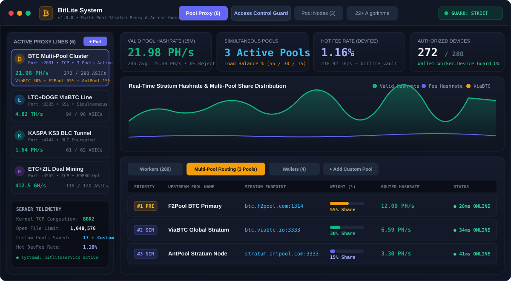
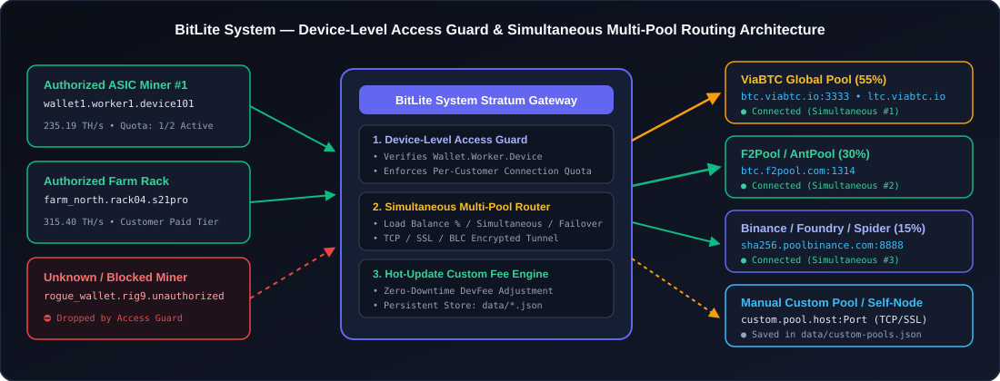
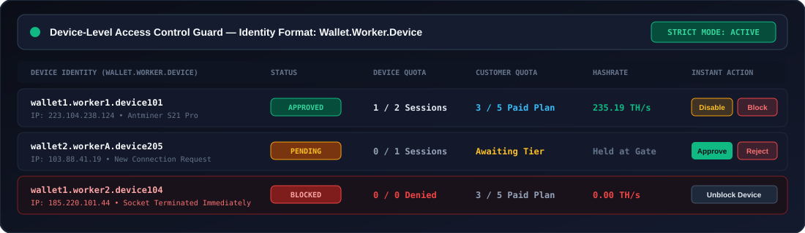
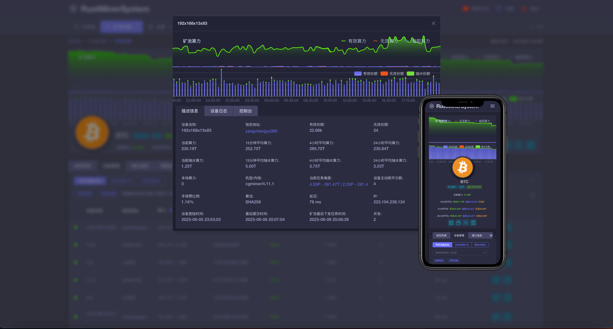
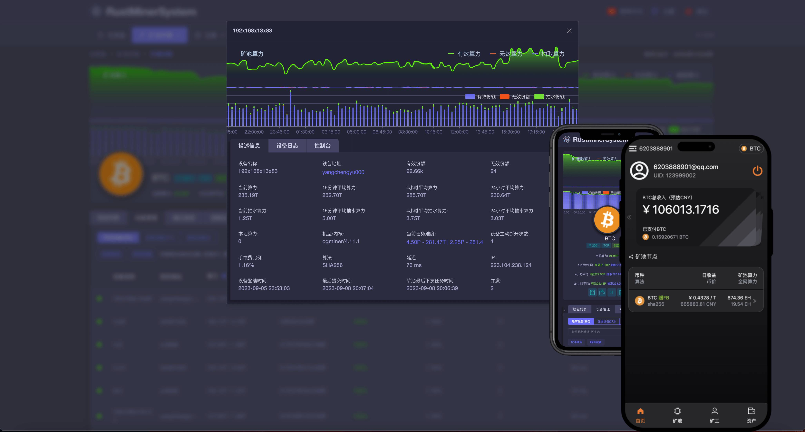

<div align="center">


# BitLite System

**Multi-Pool Stratum Proxy, Self-Hosted Pool Node Gateway & Device-Level Miner Access Control**

[](https://github.com/clonerdev/BitLite-System)
[](./LICENSE)
[](#1-one-line-linux-installation-recommended)
[%20%26%20English-orange.svg)](./README.fa.md)

**[🇮🇷 مستندات کامل فارسی (Persian README)](./README.fa.md)** • **[🇬🇧 English Documentation](./README.md)** • **[📦 GitHub Repository](https://github.com/clonerdev/BitLite-System)**

<br />

<!-- Supported Coins & Famous Pools Showcase -->
<p align="center">
  
  &nbsp;
  
  &nbsp;
  
  &nbsp;
  
  &nbsp;
  
  &nbsp;
  
  &nbsp;
  
  &nbsp;
  
  &nbsp;
  
  &nbsp;
  
  &nbsp;
  
  &nbsp;
  
</p>



</div>

---

## Overview

**BitLite System** is a full-stack management console and Stratum gateway built for mining farm operators, private pool hosts, and multi-line proxy administrators. It combines **Simultaneous Multi-Pool Routing**, self-hosted pool node management, live DevFee routing, and strict **device-level access control (`Wallet.Worker.Device`)** in a single bilingual (Persian/English) web panel.

Unlike traditional single-target Stratum proxies that forward a port to only one pool and allow any miner knowing the server IP/port to connect, **BitLite System** provides:
1. **Simultaneous Multi-Pool Connections**: Connect a single listening port to multiple mining pools at the same time (e.g., **ViaBTC + F2Pool + AntPool + Custom Pool**) using percentage-based load balancing (`Load Balance %`), warm simultaneous routing, or instant priority failover.
2. **Pre-Loaded Famous Mining Pools & Manual Pool Catalog**: One-click attachment of global mining pools (**ViaBTC**, **F2Pool**, **AntPool**, **Binance Pool**, **Foundry USA**, **SpiderPool**, **Poolin**, **EMCD**, **Braiins**, **Luxor**, **2Miners**, **Kryptex**) plus manual addition of any custom Stratum pool saved persistently on the server.
3. **Device-Level Access Control Guard (`Wallet.Worker.Device`)**: Authenticates every incoming ASIC connection by its exact 3-part identity, enforces per-device and per-customer simultaneous connection quotas based on payment tier, and lets administrators immediately disconnect or block unauthorized rigs without restarting the proxy port.

---

## System Architecture

<div align="center">
  
</div>

---

## Key Features

### 1. Simultaneous Multi-Pool Routing (`چند استخری همزمان`)
- **Three Selectable Routing Modes per Proxy Port**:
  - **Load Balance (`%`)**: Split and distribute incoming miner shares across multiple pools simultaneously by custom percentage weights (e.g., `55% F2Pool` + `30% ViaBTC` + `15% AntPool`), with a one-click **Equalize 100%** button and live per-pool weight sliders.
  - **Simultaneous Multi-Pool**: Keep active Stratum sockets open to all enabled upstream pools simultaneously and route work from the lowest-latency pool node.
  - **Priority Failover**: Send 100% of traffic to Priority `#1` and instantaneously switch to `#2`, `#3`, etc. if the primary pool experiences packet loss or downtime.
- **Per-Pool Live Telemetry**: Monitor routed hashrate, accepted/rejected shares, ping latency (`ms`), protocol (`TCP`/`SSL`), and connection health for each upstream pool attached to a port.

### 2. Built-in Famous Mining Pools (ViaBTC, F2Pool, AntPool & More) & Manual Custom Pools
- **17+ Pre-Configured Famous Pool Endpoints**:
  - Select and attach **ViaBTC**, **F2Pool**, **AntPool**, **Binance Pool**, **Foundry USA**, **SpiderPool**, **Poolin**, **EMCD Pool**, **Braiins Pool**, **Luxor Tech**, **2Miners**, or **Kryptex** with a single click.
- **Manual Custom Pool Addition**:
  - Add any private or custom Stratum pool manually (`Pool Name`, `Coin`, `Host / IP`, `Port`, `TCP / SSL`, and `Traffic Share %`) directly to a proxy port or save it permanently to the server's **Custom Pool Catalog** (`data/custom-pools.json`).

<div align="center">
  <p>
    
    &nbsp;&nbsp;&nbsp;&nbsp;
    
    &nbsp;&nbsp;&nbsp;&nbsp;
    
  </p>
</div>

| Pool Provider | Supported Coins (Pre-Loaded) | Default Stratum Host & Port | Supported Protocols |
| :--- | :--- | :--- | :--- |
| **ViaBTC** | `BTC`, `LTC+DOGE`, `BCH`, `KAS`, `ETC` | `btc.viabtc.io:3333` / `ltc.viabtc.io:3333` / `kas.viabtc.io:3015` | `TCP` / `SSL` (`:3334`) |
| **F2Pool** | `BTC`, `LTC+DOGE`, `ETC`, `KAS`, `ALEO` | `btc.f2pool.com:1314` / `ltc.f2pool.com:8888` | `TCP` / `SSL` |
| **AntPool** | `BTC`, `LTC+DOGE`, `BCH`, `ETC`, `ZEC` | `stratum.antpool.com:3333` / `stratum-ltc.antpool.com:8888` | `TCP` / `SSL` |
| **Binance Pool** | `BTC`, `LTC+DOGE`, `BCH`, `ETC` | `sha256.poolbinance.com:8888` / `ltc.poolbinance.com:3333` | `TCP` / `SSL` |
| **Foundry USA** | `BTC` | `btc.foundryusapool.com:3333` | `TCP` / `SSL` |
| **SpiderPool** | `BTC`, `ETHW`, `ETC` | `btc.spiderpool.com:2309` | `TCP` |
| **Poolin** | `BTC`, `LTC`, `BCH`, `ZEC` | `btc.ss.poolin.com:443` | `TCP` / `SSL` |
| **EMCD / Braiins / Luxor** | `BTC`, `LTC`, `KAS`, `ZEC` | `gate.emcd.io:3333` / `stratum.braiins.com:3333` / `btc.global.luxor.tech:700` | `TCP` / `SSL` |
| **Manual Custom Pool** | **All 22+ Algorithms** | Any `Host:Port` defined by the administrator | `TCP` / `SSL` / `BLC` |

### 3. Device-Level Access Control (`Wallet.Worker.Device`)
- **Strict Mode & Public Mode**: Toggle between strict pre-authorization (unrecognized miners are held in the Pending Approval Queue) and public pool mode.
- **Per-Device & Per-Customer Quotas**: Enforce maximum simultaneous connections per individual ASIC (`Wallet.Worker.Device`) and per customer wallet based on their subscription/payment tier.
- **Instant Session Termination**: Disabling, revoking, or blocking a device immediately drops its active Stratum socket and prevents reconnect bypasses.
- **Disk Persistence & Audit Trail**: All device states, customer quotas, and security events are persisted in `data/access-control.json`.

<div align="center">
  
</div>

### 4. Console & Mobile Telemetry Screenshots

| Worker Telemetry & Real-Time Charts | Mobile & Multi-Device Console View |
| :---: | :---: |
|  |  |

### 5. Hot-Update Custom Fee Rate (DevFee) & Self-Hosted Pool Nodes
- **Hot-Update DevFee**: Adjust fee percentage and fee destination wallet on the fly (`Hot Fee Update`) without dropping active miner connections or resetting ASIC job difficulty.
- **Self-Hosted Pool Node Gateway**: Deploy and monitor independent pool nodes with native support for **Merged Mining** (`BTC + FB`, `LTC + DOGE + BEL`).
- **22+ Supported PoW Algorithms**: Built-in support for `SHA256`, `SCRYPT`, `ETHASH`, `ETCHASH`, `KHEAVYHASH`, `EAGLESONG`, `BLAKE2S`, `EQUIHASH`, `KAWPOW`, `AUTOLYKOS2`, `OCTOPUS`, `RANDOMX`, `BLAKE3`, `ZKPOEX`, and more.

---

## System Requirements

| Resource | Minimum (Up to 200 Miners) | Recommended (1,000+ Miners) |
| :--- | :--- | :--- |
| **OS** | Ubuntu 20.04 / Debian 11 | Ubuntu 22.04 LTS / 24.04 LTS (64-bit) |
| **CPU** | 2 vCPU | 4+ vCPU (x86_64 or ARM64) |
| **RAM** | 2 GB | 4 GB – 8 GB |
| **Network** | 100 Mbps low-latency link | 1 Gbps with Kernel TCP BBR enabled |
| **Runtime** | Node.js v20+ (for source build) | Node.js v20 LTS / v22 LTS + `systemd` |

---

## Installation & Deployment

You can deploy BitLite System either using the **automated Linux installer script** or by **building directly from source** on your server.

### 1. One-Line Linux Installation (Recommended)

Connect to your server as `root` via SSH and run the installer matching your CPU architecture:

**Linux x86_64 (Standard Dedicated / VPS):**
```bash
bash <(curl -s -L https://raw.githubusercontent.com/clonerdev/BitLite-System/main/install.sh)
```

**Unattended Direct Install (x86_64):**
```bash
bash <(curl -s -L https://raw.githubusercontent.com/clonerdev/BitLite-System/main/install.sh) --install
```

**ARM64 (`aarch64`) Servers:**
```bash
bash <(curl -s -L https://raw.githubusercontent.com/clonerdev/BitLite-System/main/arm-install.sh)
```

**ARMv7 (`armhf`) Devices:**
```bash
bash <(curl -s -L https://raw.githubusercontent.com/clonerdev/BitLite-System/main/armv7-install.sh)
```

> **Local Script Execution:** If you have already cloned this repository onto your server, make the script executable and run it directly:
> ```bash
> chmod +x install.sh
> sudo ./install.sh
> ```

#### Interactive Installer Menu Options
When `./install.sh` launches, enter the option number for the operation you want to run:
- `1` — **Install BitLite System** (clones `clonerdev/BitLite-System` into `/opt/bitlite-system` and registers `bitliteservice.service`)
- `2` — **Update Version** (pulls latest commits from `clonerdev/BitLite-System` while preserving `data/access-control.json` and `data/custom-pools.json`)
- `4` / `5` / `6` — **Start / Stop / Restart Service**
- `7` — **Change Web Console Port** (default: `63521` or `3000`)
- `8` — **Raise `ulimit` & Enable Kernel TCP BBR** (sets `fs.file-max=1048576` and `net.ipv4.tcp_congestion_control=bbr`)
- `9` — **Configure HTTPS / TLS Access**
- `12` — **Enable Systemd Autostart on Boot**
- `20` — **Reset Admin Password**
- `22` — **Install `bitlite` CLI Tool** (`/usr/local/bin/bitlite`)

---

### 2. Manual Installation from Source (Git + Node.js)

If you want to host, customize, or run the full-stack TypeScript/Express + React console directly from this repository:

#### Step 1: Install Node.js 20+ and Git
```bash
sudo apt update && sudo apt install -y curl git build-essential
curl -fsSL https://deb.nodesource.com/setup_20.x | sudo -E bash -
sudo apt install -y nodejs
node -v && npm -v
```

#### Step 2: Clone the Repository & Install Dependencies
```bash
git clone https://github.com/clonerdev/BitLite-System.git /opt/bitlite-system
cd /opt/bitlite-system
npm install
```

#### Step 3: Configure Environment Variables
```bash
cp .env.example .env
nano .env
```
Example `.env` configuration:
```ini
DEFAULT_ADMIN_USER=bitlite_admin
ENABLE_CONTROL_API=true
ENABLE_WEB_TLS=true
ENABLE_WEB_UI=true
START_PORT=3000
WEB_ACCESS_PORT=63521
SAFE_PATH=/bitlite-console
SESSION_TTL_HOURS=24
```

#### Step 4: Build & Run
For **development** (with live reload):
```bash
npm run dev
```

For **production**:
```bash
npm run build
NODE_ENV=production npm start
```
The console and API server will start on `http://0.0.0.0:3000`.

---

### 3. Running as a Background Systemd Service (Production)

To ensure BitLite System runs continuously in the background and restarts automatically if the server reboots, create a `systemd` unit file:

```bash
sudo tee /etc/systemd/system/bitliteservice.service > /dev/null << 'EOF'
[Unit]
Description=BitLite System Stratum Console & Access Control Server
After=network-online.target
Wants=network-online.target

[Service]
Type=simple
User=root
WorkingDirectory=/opt/bitlite-system
Environment=NODE_ENV=production
ExecStart=/usr/bin/npx tsx /opt/bitlite-system/server.ts
Restart=always
RestartSec=5
LimitNOFILE=1048576

[Install]
WantedBy=multi-user.target
EOF
```

Reload `systemd`, enable autostart, and start the service:
```bash
sudo systemctl daemon-reload
sudo systemctl enable bitliteservice
sudo systemctl start bitliteservice
sudo systemctl status bitliteservice
```

---

## Updating & Upgrading

### Method A: Updating a Source / Git Deployment
When new commits or releases are pushed to the repository, update your server without losing any device approvals, customer quotas, or custom pools (`data/access-control.json` and `data/custom-pools.json` are preserved):

```bash
cd /opt/bitlite-system

# 1. Back up your persistent databases before updating
cp data/access-control.json data/access-control.backup-$(date +%F).json
[ -f data/custom-pools.json ] && cp data/custom-pools.json data/custom-pools.backup-$(date +%F).json

# 2. Pull the latest changes
git pull origin main

# 3. Install any new packages and rebuild frontend assets
npm install
npm run build

# 4. Restart the service
sudo systemctl restart bitliteservice
```

### Method B: Updating via `install.sh` or `bitlite` CLI
If you deployed via the installer script, you can update directly from `https://github.com/clonerdev/BitLite-System` with a single command:
```bash
bitlite update
```
Or run the interactive menu:
```bash
sudo ./install.sh
# Select option [2] (Update BitLite System)
```
Check service health after updating:
```bash
bitlite status
```

---

## Kernel Optimization for High Miner Counts

Mining proxies handle thousands of concurrent persistent TCP sockets. Before connecting a large farm, apply the kernel network and file-descriptor optimizations:

```bash
sudo ./install.sh --bbr
```
Or manually apply `/etc/sysctl.d/99-bitlite.conf`:
```bash
cat << 'EOF' | sudo tee /etc/sysctl.d/99-bitlite.conf
fs.file-max = 1048576
net.core.somaxconn = 65535
net.core.netdev_max_backlog = 65535
net.ipv4.tcp_max_syn_backlog = 65535
net.ipv4.tcp_fin_timeout = 15
net.ipv4.tcp_tw_reuse = 1
net.ipv4.tcp_keepalive_time = 600
net.core.default_qdisc = fq
net.ipv4.tcp_congestion_control = bbr
EOF
sudo sysctl --system
```

---

## How to Configure Multi-Pool Routing & Miner Access Control

### 1. Configuring Simultaneous Multi-Pool Routing
1. Select any proxy port in the left sidebar and open the **Multi-Pool Routing (`چند استخری همزمان`)** tab.
2. Choose your routing mode:
   - **Load Balance (`%`)** to distribute hashrate across multiple pools by percentage weight.
   - **Simultaneous Multi-Pool** to keep simultaneous warm connections open to all listed pools.
   - **Priority Failover** to use secondary pools strictly as backup lines.
3. Click any pool in the **Famous Pools Catalog** (**ViaBTC**, **F2Pool**, **AntPool**, **Binance Pool**, **Foundry USA**, etc.) to attach it in one click, or fill out the **Add Custom Pool Manually** form to add any private/custom Stratum host and port.

### 2. Miner Worker Naming Format (`Wallet.Worker.Device`)
When **Device-Level Access Control** is enabled, configure your ASIC miner's **Worker / User** field in the miner web interface using the 3-part dot-separated format:

```text
WalletAddress.WorkerGroup.DeviceID
```

**Examples:**
- `wallet1.worker1.device101`
- `farm_north_btc01.rack04.whatsminer19`
- `scrypt_king_88.hallA.l7_unit04`

### 3. Approving Devices & Setting Connection Quotas
1. Open the web console and navigate to **Access Control (کنترل دسترسی)**.
2. **Strict Mode (Default)**: Any new miner attempting to connect with an unrecognized `Wallet.Worker.Device` is denied and placed under **Pending Approval Requests**.
3. Click **Approve** next to the pending device, or use **Pre-Authorize Device** to whitelist a `Wallet.Worker.Device` ahead of time.
4. Set the **Per-Device Connection Limit** (e.g., `1` connection per ASIC) and the **Customer Quota** (e.g., `10` simultaneous connections for `farm_north_btc01`) according to the customer's payment plan.

---

## CLI Reference (`bitlite`)

Install the CLI shortcut by running `sudo ./install.sh --cli`. Available commands:

| Command | Description |
| :--- | :--- |
| `bitlite status` | Show systemd service health, active ports, and kernel BBR state |
| `bitlite start` | Start the BitLite System service |
| `bitlite stop` | Stop the BitLite System service |
| `bitlite restart` | Restart the service and reload configuration |
| `bitlite logs` | Tail live service logs (`journalctl -u bitliteservice -f`) |
| `bitlite update` | Pull latest release from `clonerdev/BitLite-System`, rebuild, and restart |

---

## REST API Reference

BitLite System exposes a JSON REST API for integrating billing panels, custom pool catalogs, or external farm automation:

- `GET /api/access-control/state` — Retrieve full device registry, customer quotas, global mode, and audit logs.
- `POST /api/access-control/toggle` — Enable or disable strict access control (`{ "enabled": true }`).
- `POST /api/access-control/connect` — Validate and establish a session for a `Wallet.Worker.Device` (`{ "identity": "wallet1.worker1.device101", "ip": "223.104.238.124", "hashrate": 235.0 }`).
- `POST /api/access-control/device-action` — Execute admin actions (`approve`, `enable`, `disable`, `reject`, `block`, `unblock`, `revoke`, `disconnect`, `set_limit`).
- `POST /api/access-control/authorize-new` — Pre-authorize a new `Wallet.Worker.Device` and set customer tier limits.
- `POST /api/access-control/customer-limit` — Update a customer wallet's maximum simultaneous connections based on payment verification.
- `GET /api/pools/custom` — Retrieve all manually added custom mining pools persisted on the server.
- `POST /api/pools/custom` — Add a new custom mining pool (`name`, `coin`, `host`, `port`, `protocol`, `region`, `feeNote`) to the global catalog.
- `DELETE /api/pools/custom/:id` — Remove a custom pool from the global catalog.

---

## Project Structure

```text
├── data/
│   ├── access-control.json               # Persistent device permissions, customer quotas & audit logs
│   └── custom-pools.json                 # Persistent catalog of manually added upstream Stratum pools
├── image/
│   ├── bitlite-hero-preview.svg          # Console & Simultaneous Multi-Pool Routing UI preview
│   ├── bitlite-multipool-architecture.svg# System & Multi-Pool Routing architecture diagram
│   ├── bitlite-access-guard.svg          # Device-Level Access Control Guard visual preview
│   └── icon-*.png / hd_logo.png          # Coin icons, ViaBTC/AntPool/Poolin logos & UI screenshots
├── src/
│   ├── App.tsx                           # Main console workspace (Multi-Pool Proxy, Nodes, CLI, Modals)
│   ├── AccessControlPanel.tsx            # Device-Level Access Control & Customer Quota Manager
│   ├── mockData.ts                       # Proxy port profiles, Famous Pool Catalog & 22 PoW algorithms
│   ├── types.ts                          # TypeScript interfaces for multi-pool targets, workers & access store
│   ├── index.css                         # Tailwind v4 styling & typography (Vazirmatn, Plus Jakarta, IBM Plex Mono)
│   └── main.tsx                          # React application entry point
├── server.ts                             # Express backend server, Stratum access guard & custom pool store
├── install.sh                            # Linux x86_64 installation & service management script
├── arm-install.sh                        # ARM64 installer script
├── armv7-install.sh                      # ARMv7 installer script
├── README.md                             # English documentation
└── README.fa.md                          # Persian documentation (مستندات فارسی)
```

---

## Security Checklist

1. **Change Default Credentials**: Immediately after first login (`bitlite_admin`), open **Security & Settings -> Login Password** and update both the username and password.
2. **Enable Two-Factor Authentication (2FA)**: Scan the TOTP QR code with Google Authenticator in **Security & Settings -> Two-Factor Auth (2FA)**.
3. **Customize Web Port & Safe Path**: Change the default web console port and configure a custom `Safe Path` (e.g., `/bitlite-console`) to prevent automated port scanners from discovering the login page.
4. **Backup `data/` Directory**: Regularly back up `data/access-control.json` and `data/custom-pools.json`, and export your proxy port configurations via the **Export Ports** button in the top toolbar.

---

## License

Released under the [MIT License](./LICENSE).
